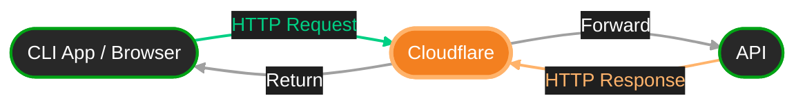
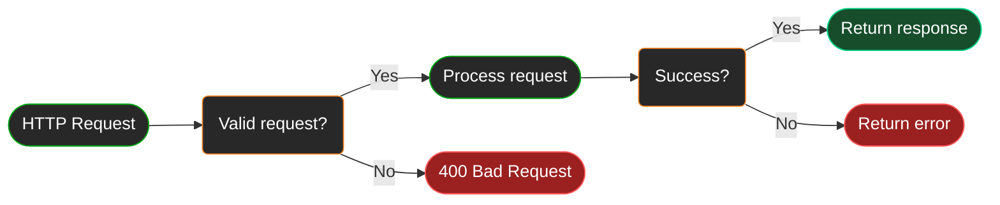

# How our APIs work
## Base concept
**The base concept is:**

## Error handling
Common HTTP status codes returned by our APIs[^1]:

| Status | Meaning                                    |
|:------:|:-------------------------------------------|
|  200   | Request succeeded                          |
|  400   | Invalid request                            |
|  401   | Authentication required                    |
|  403   | Access denied                              |
|  404   | Not found                                  |
|  429   | Rate limited (for APIs needing protection) |
|  500   | Something went horribly wrong              |

[^1]: These are not all possible response codes. This list may be expanded in the future.
